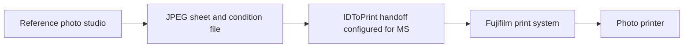

# Print pipeline from the supplied folders

Checked 12 October 2026: `Photomatic7/Backup`, the desktop `_IDStationInstaller`
and `FUJIFILM_DE100` folders, and the installed templates. No installer ran, no
job was submitted and no printer settings changed. The repeatable
[metadata audit](standards/print-reference.json) excludes customer images, printed
codes and customer/order names.

## Finished Backup output

There are **15 job directories**, each with `IDStation.jpg`, `condition.txt`, an
empty `end.txt` and a timestamped `Done.txt`. All JPEGs are **1844 × 1240 pixels**,
tagged **96 × 96 DPI**, with no embedded ICC. Their identical quantization tables
match Pillow's quality-100 setting; this does not establish every encoder setting.

| Output visually inspected | Count |
|---|---|
| UK paper, four clockwise-rotated portraits | 10 |
| UK paper, six clockwise-rotated portraits | 2 |
| UK Online Renewal, portrait plus code/information panel | 1 |
| India Passport, four upright square portraits | 1 |
| Greece Passport, four rotated portraits | 1 |

The sheets contain cut guides and document/order text. Some include Fujifilm
branding; the online sheet includes the provider's code, instructions, store
details and local accepted-check result. Our independent equivalents need
Tuttoprint branding and its own code/service details. Local acceptance printed on
a sheet does not establish government acceptance.

These are processed outputs. They establish layout and print handoff, but cannot
alone reveal the original crop, enhancements or complete quality-score algorithm.
The customer images and issued code are not copied into the repository.

## Job instructions

All 15 condition files contain these values:

| Field | Value |
|---|---|
| `OutDevice/DeviceName` | `PICsRGB` |
| `ImageList/ImageCnt` | `1` |
| `ImageList/1` | `IDStation.jpg` |
| `IDStation.jpg/SizeName` | `6x4\|GLOSSY_PIX\|3\|NORESIZE\|I2Off` |
| `PrintCnt` | `1` |
| `Resize` | `NONE` |
| `DSC_Chk` | `FALSE` |
| `BackPrint` | `FREE` |

Copy count refers to sheets, independently of how many portraits occupy a sheet.
The originals also carry separate backprint text. The exact composite size
descriptor must be retained when testing the existing consumer; its undocumented
tokens remain opaque rather than guessed at.

The files suggest a folder-based handoff with readiness and completion markers.
Their exact write order, failure handling and status semantics need a controlled
test or a consumer trace. `Done.txt` alone does not prove physical printing.

The JPEG's 96-DPI tag is not the job's paper-size instruction. Our earlier 301-DPI
sheet-size calculation describes imported template geometry, not the complete
existing print path. The downstream size configuration determines how the raster
is handled. Reading only the JPEG DPI would yield the wrong document size.

## Measured layout differences

Repeated portrait matching found these anchors, in sheet pixels. Correlations of
matching content exceeded 0.9999; physical dimensions have not been measured.

| Example | Photo top-left coordinates |
|---|---|
| Four-photo UK | (59,59), (673,59), (59,661), (685,661) |
| Six-photo UK | (59,47), (638,47), (1217,47), (59,756), (638,756), (1217,756) |
| India square | (12,12), (626,12), (12,614), (626,614) |
| Greece | (71,71), (841,71), (71,604), (841,604) |

The six-photo output matches the **loose installed `35x45 6-up.XML`**, with 300-DPI
geometry and its lower row at y=64 mm. The Print2Hotfolder family's same-named
layout has 301 DPI and y=66 mm, so it does not match that output.

Four-photo UK positions match `35x45 4-up2` converted at 300 pixels per inch,
although the saved copies declare 301. India matches the Print2Hotfolder square
layout's coordinates at 300. Greece matches the loose installed `40x60 4-UP.XML`
coordinates at its stored 301. **One global DPI override is therefore insufficient.**
Compare each actual layout and conversion path. Guide colours, footer text and
code-panel generation also differ from our prototype renderer.

## Frontier installer

| Archive | Country XMLs | Print XMLs | Saved printer |
|---|---|---|---|
| `Photomatic7_Frontier.7z` | 138 | 36 | Print2Hotfolder |
| `Photomatic7_ASK.7z` | 138 | 45 | FUJIFILM ASK-300 |

Inspected Frontier layouts enable print-to-file; ASK layouts select direct
printing. The historical 14 December 2023 installation log records extraction of
the Frontier package, installation of `IDToPrint.exe` and `IDToConfig.exe`, and
**Configuration set to MS**. It records skipping ASK driver installation.

This explains the intended separation between generating passport sheets and
Fujifilm printer handling. It does not reveal today's watched-folder path or all
live MS settings. These installer packages are older/smaller than the active
208-profile installation and must not replace it wholesale.

## DE100 processing data

The completed inspection found **402 files**: 327 ICC, 42 DAT, 30 PRN, one CSV and
two temporary consumable files. ICC files are split between current, old and dated
backup collections. The current `data/ICC` collection has 48 files in each of
`HQ`, `NQ_NFT` and `NQ_FFT`: **144 readable current profiles**.

Across all collections, 326 ICC files are readable RGB-to-RGB **device-link**
profiles. One old `ICC_old/NQ_NFT/DE100_sRGB_Lustre_v14.icc` is empty; current
equivalents are readable. The overall ICC collection contains 41 distinct byte
contents, including that empty old file.

Device-link profiles are printer transformations, not ordinary source-camera
profiles. Do not embed them in every customer JPEG or apply them twice. Establish
one colour-conversion owner and the correct paper/quality settings. `PICsRGB` is
consistent with an sRGB job path, but does not establish the full transform chain.

DAT/CSV files are vendor calibration data whose complete formats are unresolved.
PRN files are named cleaning jobs, not passport layouts. They were not sent to a
printer. Consumable temporary files are not portable photo-processing settings.

## Applying this to our software

Our own studio can generate completed sheets and an independent print-job packet
for a tested Fujifilm path. Camera integration is unnecessary for file upload.
Reproduce measured layout choices, orientation, guides and text; generate our own
code panel; establish the live MS or standard-driver connection; publish packets
only after their files are complete; distinguish submitted jobs from confirmed
printing. Printer colour processing must remain separate from the stored code JPEG.

The files provide substantial reference evidence. A physical ruler/colour test,
the exact live queue configuration, native biometric calibration and independent
Irish service authorization remain separate work.
