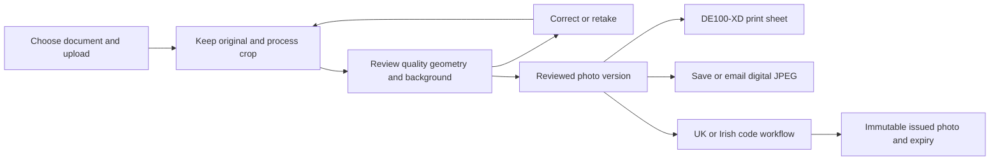

# Tuttoprint Photo Studio requirements and reference audit

Updated 12 October 2026.

Tuttoprint needs its own photo studio software with the familiar operation of the
supplied Photomatic system: choose a document, upload a photo, automatically frame
it, inspect and correct it, then print or deliver the digital photo. TuttoCode is
the codebase and UK code service foundation. The implementation is independent;
the supplied installation defines reference behaviour and settings.

The user confirmed **file upload and printing on a Fujifilm DE100-XD**. Camera
control, card readers and wireless camera transfer are not required for this
workflow. All supplied country/document profiles must be available. Online
passport codes are limited to UK and Irish passports. Irish code integration is
unfinished. The current branch is a prototype, not a complete replacement.

## What matching the software means

The staff should be able to complete the same photo job with familiar controls,
the correct country framing, useful checks and equivalent print/export results.
The screen arrangement should retain the large photo, accessible move/zoom/rotate
controls, country selector, three inspection categories and output actions.
Tuttoprint owns the application identity, processing pipeline, job records,
configuration and code delivery. Legacy registration, upload-credit counters,
printer-based licensing and shared mail services are not requirements for this
independent system.

Numeric proprietary quality scores are not interchangeable with MediaPipe or
OpenCV results. A score of 100 in the old program cannot be recreated by assigning
100 to a successful new check. The new engine needs defined measurements,
calibration and measured outcomes. Unknown results must remain unknown. Government
acceptance remains a separate event from passing a local check.

## Reference evidence

The machine-readable [reference audit](reference-audit.json) records allowlisted
settings and source hashes. Run `python3 scripts/audit_reference.py /path/to/Photomatic7
--output docs/reference-audit.json` to repeat the inventory. It reads metadata;
it does not execute the supplied Windows software or copy credentials.

| Evidence | What it establishes |
|---|---|
| Eight supplied screenshots, 12 October 2026 at 18.25.22–18.26.41 | Actual visible shop screens: startup, document selection, crop controls, geometry, background, measurements, online upload |
| `Packages/Countries`: 208 XML files | Document-specific crop, background, output and workflow settings; 208 profiles, not 208 distinct countries |
| `Packages/Printer`: 169 XML files | 36 Print2Hotfolder, 45 ASK-300, 40 Sinfonia layouts and 48 loose layouts; none is a DE100-XD device profile |
| `Packages/Save` and `Packages/Email`: 7 and 12 XML files | Export dimensions and separate save/email configuration |
| `Packages/ICAO`: 3 XML files | Check switches and legacy thresholds, including a separate NSW TAXI quality profile |
| `Config/Photomatic7.xml` | Saved defaults and feature switches; these can differ from the running screenshots |
| `Images/en/languagedata.XML` | Screen/control inventory, including print, crop, background, editor and setup functions |
| Country Templates manual, pp. 4–6 | Country selection controls the entire processing and output workflow |
| Dutch 7.3 manual, pp. 6–11 | Capture alternatives, review/correction, layout cycling, DUO printing, save and email |
| Background manuals, English, pp. 2–6 | Preview, automatic/manual background correction, test, undo and accept/cancel |
| How to Save, pp. 1–4; How to Email, pp. 1–5 | Recipient/destination, filename and dimensions can be changed; selected country controls format |
| IDstation.online manual, pp. 9–12 | Customer information/consent, upload, unique reference, printout and customer access; describes the historical provider service |
| 3 BIN files manual, pp. 1–4 | Driver settings and print-only colour corrections are separate from image processing |

DLL names such as FaceIt, Canon EDSDK and Sinfonia libraries indicate packaged
dependencies. Their presence does not establish current hardware, documented
interfaces, or reproducible algorithm behaviour. The DE100-XD is confirmed by the
user, rather than inferred from those files.

## The job workflow

1. **Choose the country and document.** Distinguish paper passport, online passport,
   visa, ID and free-style profiles. Show physical dimensions, digital requirements
   and the default print layout. Keep an explicit shop default separately from the
   selected job profile. Provide the reference selector's country, print-size,
   online and all-template views, plus search.
2. **Upload the original.** Correct EXIF orientation, decode supported formats and
   reject unreadable/oversized input. Keep the original while the job is editable.
   A different camera requires no integration when it supplies an image file.
3. **Process automatically.** Detect the face and landmarks, establish head/eye
   position, crop to the selected profile and preserve facial proportions. Keep
   the crop transform and profile version so the result can be reproduced.
4. **Review the three categories.** Image quality, face size/position and
   background each open details. Guides are view aids and never appear on the
   exported photo. Missing measurements must not produce a green approval.
5. **Correct and recheck.** Move, zoom, rotate by small angles or quarter turns;
   preview edits, apply or cancel them, and rerun affected checks. Changing country
   invalidates the previous crop/checks and requires processing for the new profile
   before an output can be labelled with that profile.
6. **Deliver one or several outputs.** Print preview, digital Save, email and UK/IE
   passport code are separate actions on a reviewed job. Printing is not proof of
   code issuance; downloading an image is not proof of physical printing.
7. **Finish and manage the job.** Record output/issue outcomes, allow reprint while
   retained, expire the photo/code, and support deletion. Issued photo bytes are
   immutable; a changed photo requires a new issuance.

## Country and measurement details

The screenshot's **United Kingdom Online Renewal** is a distinct profile from
both UK paper and the separate `UK online` file. Its stored format is 50 × 70 mm;
its online export is 800 × 1120 px; the head target/range is 36% / 30–44%; the eye
line is measured from the top, target/range 32% / 24–50%; the preferred background
is RGB 248 with per-channel bounds 192–255. The shown 44.87% head measurement is
above that profile's 44% maximum, consistent with its red geometry indicator.
The displayed width limits do not prove width enforcement: this profile enables
height-based framing and disables width-based framing.

UK paper instead uses 35 × 45 mm with imported head target/range 70% / 64–75%
and eye target/range 48% / 42–54%. Irish online exports 715 × 951 px. These settings
must stay profile-specific. The saved startup default is UK paper while the
screenshots later select UK Online Renewal; neither should overwrite the other.

The new geometry view must show input dimensions, source crop dimensions, output
dimensions, eye coordinates/distance/angle, eye line %, and enabled head/width
measurements in both % and mm. It needs the reference frame, measurement method
and applicable range. Source-space eye distance and output-space eye distance
must not be confused. Visible hair crown, anatomical crown and forehead landmarks
are different measurements: the current segmentation-based crown requires
calibration against examples before being treated as equivalent to the old engine.

The legacy detailed screen also has motion blur, artefacts, noise, compression,
lighting and biometric scores. Some expression fields show -1 and other checks
are explicitly untested. Our implementation should expose genuine check coverage,
not fill absent fields with invented scores. Age is selected by staff for policy
exceptions; legacy age/gender estimation is not needed to complete the confirmed
photo job.

Important template rules still missing from runtime policy include Australia's
DFAT background-tool block, forced cut marks in ten profiles, NSW TAXI's
`NOlevels.XML` override, and country-specific print compliance restrictions.
These are part of loading profiles properly, beyond displaying all names.

Ten supplied profiles have material differences between their physical and
required digital aspect ratios. A second centre-fit after the print crop can
change eye/head placement. Each digital deliverable needs its own final geometry
validation, not just a correct pixel count.

Further static inspection found width-first framing in the supplied `AutoCrop7`
and `AutoCrop7N` routines. Both Irish online profiles enable width and height;
the prototype currently chooses height first. See the
[standards decoding notes](STANDARDS_DECODING.md) for this discrepancy and the
verified default/check comparison logic.

## Background and editing

Background review must compare the selected profile's permitted colour range,
uniformity and shadows. The reference provides a before/after view, automatic and
manual correction, test again, undo and save/cancel. Tuttoprint needs equivalent
control with its own mask/editor and an edit history. A change can damage hair or
clothing edges even when a flat background colour passes a numerical check.

Editing policy must depend on document and output purpose. UK guidance requires
photos unaltered by software; Irish guidance prohibits digital enhancement or
changes. AI should locate, measure, frame and flag problems; unsupported face or
background alteration must not silently enter a passport-code output. General ID
editing and printer colour management should remain separate operations.
Sources: [UK printed photo rules](https://www.gov.uk/photos-for-passports/photo-requirements),
[Irish photo guidelines](https://api.ireland.ie/en/dfa/passports/photo-guidelines/).

## Printing on the Fujifilm DE100-XD

The user's printer replaces assumptions about the old ASK-300, Sinfonia or earlier
Mitsubishi references. Fujifilm provides standard Windows/Mac driver support,
printer profiles and a workflow-software option. A manual browser/OS print dialog
can be the initial connection; unattended printing/status would require a local
adapter. Neither is a camera requirement.
Sources: [DE100-XD brochure](https://asset.fujifilm.com/www/au/files/2023-10/41a02782ce9cf95a27fd6bae6a695a99/DE100-XD-Brochure-AU.pdf),
[official resources](https://www.fujifilm.com/es/en/business/photofinishing/frontier-dry/de100xd/resources).

DE100-XD roll widths include 102 and 152 mm, and lengths are configurable within
the supported range. Printhead resolution is 1200 × 1200 dpi in standard mode;
that number is not automatically the resolution needed for an input sheet.
The application must use the chosen driver's document size and input resolution.
Source: [DE100-XD specifications](https://www.fujifilm.com/de/en/business/photofinishing/frontier-dry/de100xd/specifications).

The imported default sheet is 1844 × 1240 px at 301 dpi, approximately
155.6 × 104.6 mm. It is **not** a verified DE100-XD 152 × 102 mm sheet. Fitting its
155.6 mm width onto 152 mm would shrink a 35 mm photo to about 34.2 mm.
Changing only a printer name would leave this error. Define a DE100-XD sheet in
physical mm for the loaded roll/cut length, place each photograph at its required
mm size, then rasterise. Keep all imported layouts as reference data, not as proof
of device calibration.

The fourth-edition guide linked by Fujifilm's DE100-XD resources distinguishes
**Borderless (Auto Expand)**, which enlarges the image, from **Borderless (Retain
Size)**, which expects application-supplied bleed. Its retain-size instructions
add 1.69 mm on each side of the paper width. The sheet implementation therefore
needs separate paper, bleed and photo coordinates; simply selecting borderless
printing can change passport dimensions. Confirm these options in the installed
DE100-XD driver. Choose one colour-management owner: application-managed colour
requires driver colour correction off. Source: [Fujifilm fourth-edition guide,
sections 3.2.1.3 and 3.2.2](https://asset.fujifilm.com/master/emea/files/2021-08/7f59257f96b4c043d1f9e83ba58fe42d/DE100_OperationGuide_4th_Edition.zip).

The print workflow needs preview/layout selection, copy count, cut-mark and
oversize policies, its own branding/code text, and explicit success/failure state.
DUO printing is a documented legacy feature for two different portraits on one
sheet; it is not implemented. Colour calibration must use the DE100-XD driver and
matching paper profile. Sinfonia BIN presets cannot be reused on this printer.
Print-only corrections must not modify the stored code JPEG.

A real calibration job must check each photo with a ruler, borderless expansion,
cut positions, paper type and colour settings. Test 35 × 45, 51 × 51 and 50 × 70 mm
photos and the code area. A proposed size tolerance is ±0.5 mm, subject to the
document's actual rules. Loaded roll width, selected cut length and the shop print
computer/driver are still to be established. Physical printing has not been tested.

Further supplied Backup jobs and installer evidence establish a folder-based
sheet/instruction handoff through an IDToPrint setup configured for Fujifilm MS.
The finished JPEGs have 96-DPI tags; matching their placement requires checking
the actual layout/conversion and downstream settings. The six-photo example
matches a loose 300-DPI template rather than the 301-DPI printer-family default.
See [the print pipeline evidence](PRINT_PIPELINE.md) before choosing the device
adapter or treating template DPI as physical output calibration.

The [official-rule comparisons](OFFICIAL_VALIDATION.md) also identify material
printer constraints: Australian passport prints require dye sublimation, while
the DE100-XD is inkjet. The country policy must include output-method restrictions
in addition to image dimensions.

## Our code and delivery system

The UK service already generates Tuttoprint's own short code and stores the photo
in our database/file storage. HMPO retrieves it from our HTTPS host using a signed
request. The endpoint validates the signature and matching URL. This architecture
does not need IDstation.online for UK codes. Hosting and a real application
retrieval test are still required to validate a changed deployment.
Source: [HMPO supplier protocol](https://www.passport.service.gov.uk/help/photo-codes).

Irish Passport Online uses participating providers. The current codebase has no
Irish issuance/retrieval adapter. An independently generated UK-style URL is not
evidence of Irish acceptance. Establish the Irish provider/onboarding protocol,
authorization and end-to-end retrieval before enabling its button. Until then,
Irish photo Save/Email is distinct from an Irish code.
Source: [Irish photo code options](https://api.ireland.ie/en/dfa/passports/photo-guidelines/).
See [the integration research](IRISH_CODES.md).

Our issue screen needs customer contact where delivery requires it, recorded
confirmation that the customer was informed and agreed to storage, staff review,
and a recorded exception reason where applicable. Validate these on the server.
A failure/timeout must not show an issued/sent result. Retries must reuse the same
issuance rather than create conflicting codes. Customer photo access/deletion
needs its own protected flow; do not make the HMPO-only URL a public gallery.
Keep retention an explicit Tuttoprint policy: the prototype's 24-hour pending and
30-day issued periods differ from the historical manual's six months.

## Current implementation gaps and acceptance checks

Status is based on source review of the current branch. Existing tests establish
software behaviours only; they do not establish complete parity or printer output.

| Requirement | Current state | Completion check |
|---|---|---|
| Own application identity | Tuttoprint name now replaces the station's Photomatic name/background | No old application/provider branding in screens or new print artwork; source provenance remains documented |
| All country/document profiles | 208 imported; exceptions only partly represented | Every profile's active switches, exports and default layout resolve, including NSW TAXI and DFAT restrictions |
| Selector and defaults | Search exists; reference views/default management missing | Country/size/online/all views work and changing shop default does not rewrite a job |
| File upload | Exists, including EXIF orientation and optional HEIC decoder | Landscape/portrait/HEIC, unreadable input, oversized file and multiple faces tested |
| Automatic crop | AI landmarks/mask plus imported targets | Paired reference photos across document sizes and different hair/head shapes match agreed framing tolerances |
| Fine crop adjustment | Zoom/move and quarter turns exist | Visible controls, ±1° rotation, reset and apply/cancel recheck geometry without repeated JPEG degradation |
| Final geometry checks | Out-of-range head/eye values currently warnings | Active violations are shown consistently; output policy distinguishes override from a passing check |
| Quality measurements | Heuristics exist; only MaxAngle uses imported quality settings | Defined units/methods, profile-specific switches and meaningful measured/unmeasured results; no copied proprietary score scale |
| Children/babies | UK-style relaxations applied globally; facing check still enforced | Exceptions follow the selected country's policy and staff age selection |
| Background workflow | Automatic replacement/evening exist | Manual preview/undo/test/save/cancel; blocked tools respected; edited passport-code output prevented by policy |
| Country change after processing | Client changes label/guides before server reprocess | Export/issue cannot use stale photo/checks under a newly selected profile |
| Print layout compatibility | Size-format matching exists; force-country/compliance rules incomplete | Restrict layouts using all active rules; no country-specific layout offered incorrectly |
| DE100-XD output | Generic JPEG/browser preview only | Correct roll/cut dimensions, 100% scale, orientation and physical measurement on the actual printer |
| Print copies, calibration and DUO | Missing | Copies/layout options, two-photo sheet, own artwork and independent print colour settings verified |
| Save and Email | Profile dimensions; download and configured SMTP exist | Recipient/name/size controls, min/max bytes checked on final deliverable, digital framing rechecked, visible actual delivery outcome |
| Final file byte validation | Processing checks a candidate; Save re-encodes without enforcing minimum | The exact bytes served/downloaded/emailed meet that deliverable's own limits; declared units and boundary cases tested |
| UK code | Own generator and signed retrieval exist | Required review/consent stored server-side, immutable exact issued bytes, expiry and real HMPO retrieval after deployment |
| Irish code | Explicitly disabled | Actual Irish provider authorization, protocol and successful Passport Online retrieval |
| Code review and exceptions | Visual review only browser-required; override lacks reason/history | Direct POST cannot bypass consent/review; staff identity, reason and photo version recorded |
| Job lifecycle and concurrency | Retention and issued-crop lock exist | Atomic issue/edit/reject transitions, idempotent retries and file/DB consistency under concurrent requests |
| Job history, reprints and privacy | Basic staff history/deletion exists | Output events and failures recorded; accurate access controls, retention and deletion behaviour |
| Configuration/template maintenance | Importer, JSON and environment settings | Own versioned profile/layout editor, safe validation, rollback and official-rule provenance/date |

## Build order and release evidence

1. Complete the independent profile and job model: active template rules, versioned
   crop/check data, final-deliverable validation, review/consent and atomic issuance.
2. Complete the familiar operator workflow: document views, visible fine controls,
   measurement/background inspectors and save/email/code dialogs.
3. Implement and calibrate DE100-XD output for the actual paper configuration;
   replace provider-specific sheet artwork with Tuttoprint artwork.
4. Validate UK issuance through the existing own service and establish the Irish
   connection. Release each code service only after its real retrieval succeeds.
5. Run paired photo jobs and print/export comparisons covering paper/online UK,
   Irish paper/online, US square, Canada, Finland, a blue-background document,
   free-style, DFAT and NSW TAXI. Include tilted/blurred/low-resolution images,
   children, glasses, limited headroom and digital/physical ratio differences.

Full replacement is complete when staff can carry out the confirmed workflow on
the shop computer and DE100-XD with correct physical prints, valid digital outputs,
and verified code delivery. Kiosk payments, camera tethering, wireless capture and
France/Germany external submissions appear in the installed suite, but are outside
the user's confirmed file-upload/DE100-XD workflow. Their presence is recorded;
they should not delay or be represented as completed parts of this replacement.
